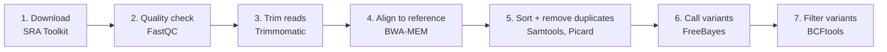
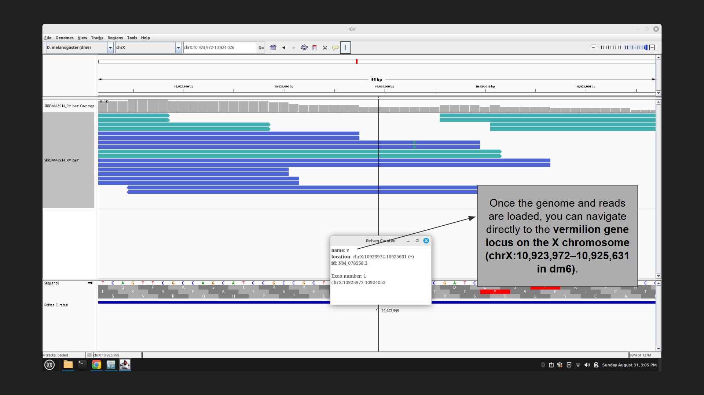
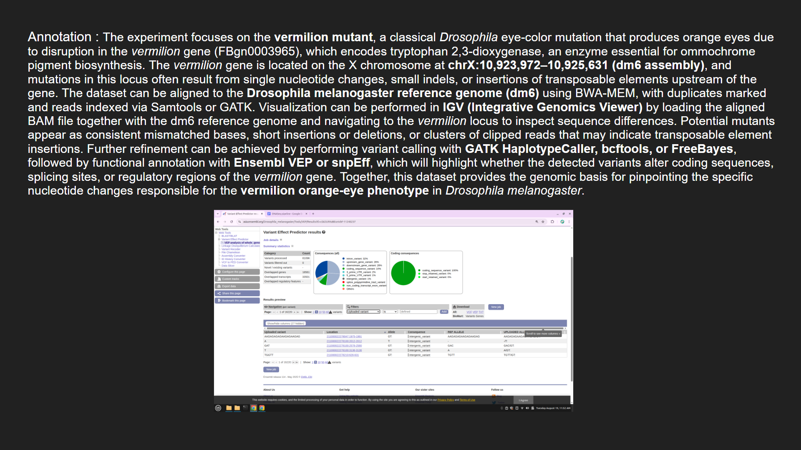
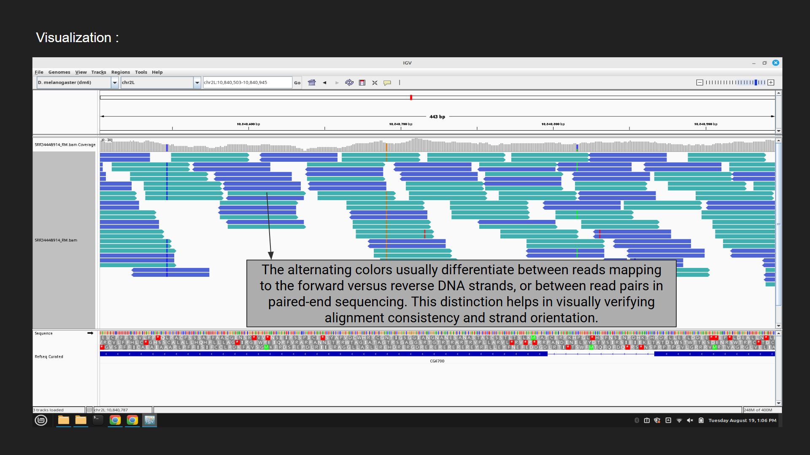
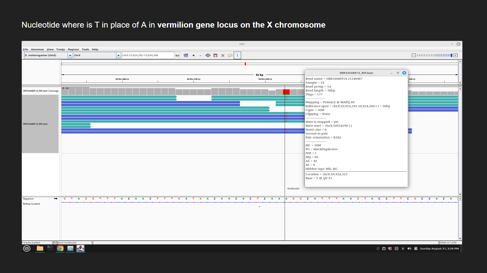

# Whole Genome Sequencing (WGS) Variant Calling Pipeline

A step-by-step pipeline that takes raw Illumina reads from NCBI SRA and produces a filtered list of genetic variants (SNPs and indels) for *Drosophila melanogaster*.

**In one sentence:** raw DNA reads go in, quality-checked and filtered variants come out.

**Tools:** SRA Toolkit · FastQC · Trimmomatic · BWA · Samtools · Picard · FreeBayes · BCFtools

---

## What is Whole Genome Sequencing?

Whole genome sequencing (WGS) reads the complete DNA sequence of an organism. Comparing those reads to a reference genome reveals variants: places where this individual differs from the reference.

## Dataset

| | |
|---|---|
| Organism | *Drosophila melanogaster* (fruit fly), male, whole body |
| SRA experiment | SRX29609289 (run `SRR34448914`) |
| Sequencing | Illumina NovaSeq 6000, paired-end |
| Size | about 33 million read pairs, roughly 18x coverage of the ~180 Mb genome |
| Library prep | NEBNext Ultra II DNA Library Prep Kit (PCR-amplified, so duplicate removal is needed) |

## Workflow



| Step | Script | What it does |
|---|---|---|
| 1 | `scripts/01_download_sra.sh` | Downloads the paired reads from NCBI SRA |
| 2 | `scripts/02_fastqc.sh` | Checks the quality of the raw reads |
| 3 | `scripts/03_trimmomatic.sh` | Removes adapters and low-quality bases, then re-checks quality |
| 4 | `scripts/04_bwa_align.sh` | Aligns the reads to the reference genome |
| 5 | `scripts/05_sort_markdup.sh` | Sorts the alignments and removes PCR duplicates |
| 6 | `scripts/06_freebayes.sh` | Finds variants compared with the reference |
| 7 | `scripts/07_bcftools_filter.sh` | Keeps only reliable variants |

## How to run

```bash
# 1. Get the code
git clone https://github.com/livolo/DNA-Seq-pipeline-WGS-.git
cd DNA-Seq-pipeline-WGS-

# 2. Install the tools
conda env create -f environment.yml
conda activate wgs-pipeline

# 3. Add the reference genome and set its path in scripts/config.sh

# 4. Run the steps in order
bash scripts/01_download_sra.sh
bash scripts/02_fastqc.sh
bash scripts/03_trimmomatic.sh
bash scripts/04_bwa_align.sh
bash scripts/05_sort_markdup.sh
bash scripts/06_freebayes.sh
bash scripts/07_bcftools_filter.sh
```

All settings (sample ID, threads, reference path, adapter file) are in `scripts/config.sh`.

## Results

### Quality control
FastQC reports for the raw and trimmed reads are in [`results/qc/`](results/qc/). They are HTML files, so download them and open them in a browser.

### Figures

**Gene identification**



**Variant annotation**



**Variants viewed in IGV**



**Analysis**



## Repository structure

```
.
├── README.md
├── environment.yml        # tools and versions
├── scripts/               # one script per pipeline step
└── results/
    ├── qc/                # FastQC reports
    └── figures/           # annotation, IGV and analysis images
```

Large files (FASTQ, SAM/BAM, reference genome) are not stored in the repo. The scripts create them in `data/` and `reference/` when run.

## Notes

- The analysis was first run step by step on the command line. The scripts in `scripts/` document that workflow in a reproducible form.
- Check the reference genome, adapter file and filtering thresholds in `scripts/` against your own data before reuse.

## Author

**Kirti Vishwakarma**, M.Sc. Bioinformatics
[LinkedIn](https://www.linkedin.com/in/kirti-vishwakarma-b69bb9229/) · [GitHub](https://github.com/livolo)